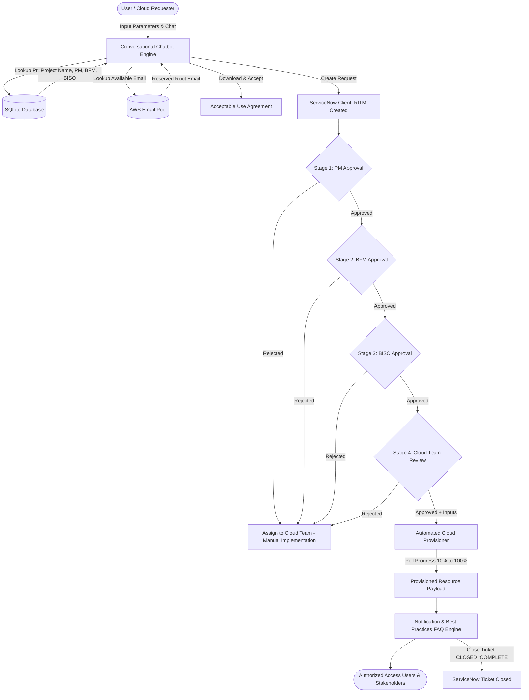

# Enterprise Multi-Cloud Provisioning Chatbot (AWS, Azure, GCP)

An enterprise-grade, conversational cloud provisioning assistant and governance workflow engine built with Python, SQLite, Jinja2, and Streamlit. The system guides engineers and managers through requesting cloud environments across **Amazon Web Services (AWS)**, **Microsoft Azure**, and **Google Cloud Platform (GCP)**, enforcing strict compliance policies, real-time database lookups, multi-stage approval hierarchies, automated resource provisioning, and ServiceNow ticket management.

---

## 🚀 Key Features & Capabilities

1. **Multi-Cloud Support**:
   - **AWS**: Provisions AWS Accounts, Organizational Units (OUs), IAM roles, and SCPs.
   - **Azure**: Provisions Azure Subscriptions, Management Groups, and Azure Policies.
   - **GCP**: Provisions GCP Projects, Organization hierarchy, and Org Policies.

2. **Automated SQLite Lookups**:
   - **Project Metadata**: Queries project code to dynamically fetch Project Name, Department, Project Manager (PM) email, Business Financial Manager (BFM) email, and Business Information Security Officer (BISO) email.
   - **AWS Email Pool**: Automatically checks and allocates available unassigned root alias emails (e.g. `aws-root-app-pool01@enterprise.corp`) from an internal SQLite pool.

3. **Strict Currency & Budget Enforcement**:
   - **AWS**: Budgets strictly required in **USD (`$`)**.
   - **Azure & GCP**: Budgets strictly required in **INR (`₹`)**.

4. **Compliance & Acceptable Use Agreement (AUA)**:
   - Built-in downloadable Enterprise Cloud Acceptable Use Agreement.
   - Chatbot verifies explicit acceptance before allowing ticket submission.

5. **ServiceNow RITM Lifecycle Management**:
   - Automatically generates ServiceNow Request Item tickets (`RITM0010201+`).
   - Tracks audit logs, stage transitions, assignment groups, and approval timestamps.

6. **4-Stage Sequential Approval Workflow**:
   - **Stage 1**: Project Manager (PM) approval (email from DB).
   - **Stage 2**: Business Financial Manager (BFM) approval (email from DB).
   - **Stage 3**: Business Information Security Officer (BISO) approval.
   - **Stage 4**: Cloud Team review, with options to specify Landing Zone parameters (Target OU, VPC CIDR, Security Guardrails).

7. **Automatic Rejection Routing**:
   - If rejected at any stage (PM, BFM, BISO, or Cloud Team), the ticket is automatically re-assigned to **`Cloud Team - For Manual Implementation`** with assignment group `Cloud Infrastructure Engineering - Manual Implementation`.

8. **Automated Account Factory & Live Polling**:
   - Upon final Cloud Team approval, automated cloud provisioning is triggered.
   - Realistic multi-stage account generation with live polling progress bars.

9. **Notification & Best Practices FAQ Delivery**:
   - Renders a responsive HTML welcome email and tailored markdown Best Practices FAQ populated with resource IDs, SSO URLs, and security guidelines.
   - Dispatched to primary/secondary owners, PM, BFM, and authorized user access list.

10. **ServiceNow Ticket Closure**:
    - Automatically closes the ServiceNow ticket as `CLOSED_COMPLETE` with detailed resolution notes.

---

## 🏛️ Architecture & Governance Workflow



---

## 📋 Input Parameters Matrix

| # | Parameter Name | Description / Validation Rules | Source |
|---|---|---|---|
| 1 | **Cloud Service Provider** | AWS, Azure, or GCP | User Selection / Chat |
| 2 | **Resource Name** | AWS Account Name / Azure Subscription Name / GCP Project Name | User Input |
| 3 | **Project Code** | Enterprise project identifier (e.g. `PRJ-AI-101`, `PRJ-FIN-202`) | User Input |
| 4 | **Project Name** | Project display name | **SQLite DB Lookup** |
| 5 | **AWS Root Email ID** | Available corporate root alias email (AWS only) | **SQLite Email Pool** |
| 6 | **Estimated Cost / Month** | Budget with strict currency: **USD (`$`) for AWS**, **INR (`₹`) for Azure & GCP** | User Input |
| 7 | **Project Duration** | e.g., `3 Months`, `6 Months`, `12 Months`, `Permanent` | User Input |
| 8 | **Business Justification** | Detailed business use case and architecture necessity | User Input |
| 9 | **Primary Project Owner** | Corporate email / name of primary owner | User Input |
| 10 | **Secondary Project Owner** | Corporate email / name of secondary owner | User Input |
| 11 | **Declaration on Type of Data** | `Public`, `Internal`, `Confidential`, `Restricted` | User Selection |
| 12 | **User Access Emails** | Comma/newline-separated list of team member emails | User Input |
| 13 | **Cloud AUA** | Cloud Acceptable Use Agreement (review and accept) | Downloadable Document |

---

## 📂 Project Directory Structure

```text
Multi_Cloud_Chatbot/
├── chatbot.py                      # Dedicated Streamlit Web Chatbot Application
├── chatbot_cli.py                  # Terminal interactive chatbot session
├── chatbot_engine.py               # State machine, parser, validation, commands
├── database.py                     # SQLite layer, schema seeding, and CRUD
├── servicenow_client.py            # ServiceNow RITM lifecycle, status, and assignment
├── approval_workflow.py            # 4-stage sequential approval engine
├── cloud_provisioner.py            # Simulated cloud factory with live polling
├── notification_service.py         # Jinja2 email templating & FAQ populator
├── test_workflow.py                # Comprehensive automated unit test suite
├── documents/
│   └── Acceptable_Use_Agreement.md # Enterprise Cloud Acceptable Use Agreement
├── templates/
│   ├── best_practices_faq.md       # Tailored Cloud Security & Governance FAQ
│   └── welcome_notification.html   # Responsive HTML welcome notification email
└── cloud_governance.db             # SQLite database (auto-generated on startup)
```

---

## ⚡ Quickstart Guide

### 1. Run the Streamlit Chatbot Web Application
```bash
streamlit run chatbot.py
```
*Features:*
- Dual-column interface: Chat dialogue on the left, live parameter tracker & active ServiceNow ticket monitor on the right.
- Download button for the Cloud Acceptable Use Agreement.
- Interactive approval control center for PM, BFM, BISO, and Cloud Team.
- Live progress bar for automated cloud provisioning.
- In-app preview of the rendered HTML welcome email and customized Best Practices FAQ.

### 2. Run the Interactive CLI Chatbot
```bash
python chatbot_cli.py
```
*Features:*
- Chat step-by-step or send natural multi-parameter queries.
- Commands: `projects`, `emails`, `status <TICKET>`, `reset`, `quit`.
- Embedded interactive simulation for 4-stage approvals and provisioning.

### 3. Run Automated Tests
```bash
python test_workflow.py
```
*Verifies:*
- Database seeding and lookups.
- AWS email pool reservation and status transitions.
- ServiceNow ticket creation and lifecycle.
- 4-stage sequential approvals.
- Rejection handling and routing to `Cloud Team - For Manual Implementation`.
- Provisioning for AWS, Azure, and GCP with strict budget currency checks.
- Notification dispatch and final ticket closure.
